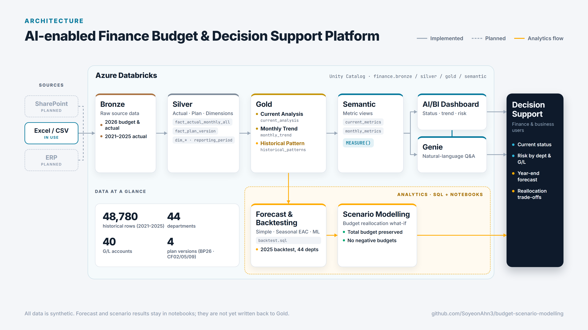
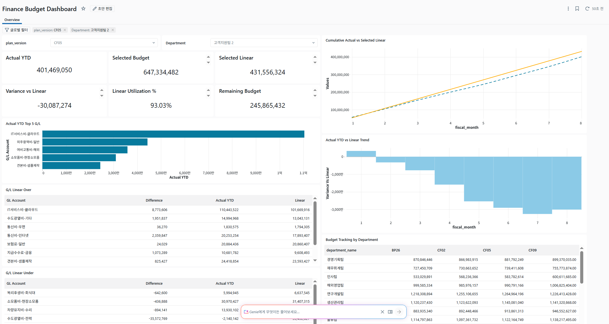
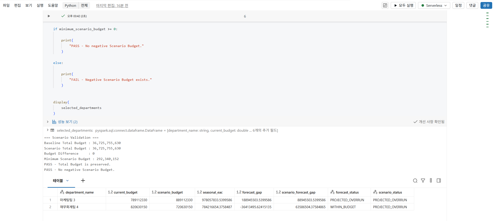
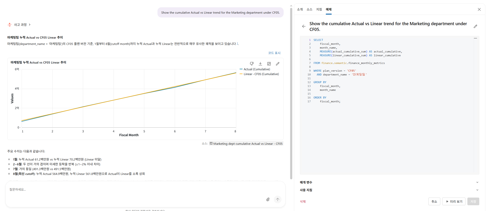

🌐 [한국어](./README_ko.md) | [English](./README.md)

# AI-enabled Finance Budget & Decision Support Platform

> Budget-vs-actual analysis, year-end forecasting, and budget reallocation what-if modeling on Azure Databricks.

https://github.com/user-attachments/assets/e50a1ab9-b22c-45d6-a9af-8236109ce7f1

## Overview

Budget, forecast, and actual figures are spread across several plan versions (BP26, CF02, CF05, CF09), which makes it hard to see which departments and G/L accounts are at risk and where spending will land at year-end.

This project consolidates the data into a Bronze → Silver → Gold → Semantic structure on Azure Databricks, exposes current status and monthly trends through an AI/BI Dashboard and Genie, compares year-end forecasting methods with backtests, and extends the forecast into a budget reallocation what-if model.

> [!NOTE]
> This is a portfolio project. All data is **synthetic**; department names and amounts do not represent a real organization.

### Key Results

| Area | Result |
|---|---|
| Year-end forecast | In the 2025 backtest (August cutoff, 44 departments), **Seasonal EAC reached 0.32% MAPE** vs. 1.10% for simple annualization: about 71% lower error, better in 41 of 44 departments |
| ML comparison | Linear Regression, Gradient Boosting, and a residual model all had higher error than Seasonal EAC (0.78%–2.57% MAPE) |
| Reallocation what-if | Moving 100M between two departments cut the target's projected overrun from 188.9M to 88.9M, but turned the source's 36.4M headroom into a 63.6M overrun |

## Table of Contents

- [Overview](#overview)
- [How It Works](#how-it-works)
- [AI Components](#ai-components)
- [Tech Stack](#tech-stack)
- [Project Structure](#project-structure)
- [Documentation](#documentation)
- [Current Status](#current-status)
- [Limitations](#limitations)

## How It Works



### 1. Data foundation

- Silver standardizes the raw files into a monthly actual fact (`fiscal_year × fiscal_month × cost_center × gl_account`), a plan version fact (BP26 / CF02 / CF05 / CF09), dimensions, and a unified 2021–2026 actual fact.
- **Cutoff month is detected automatically** as the latest month with actuals. A value of 0 counts as an actual; only NULL means missing.
- **No hard-coded years**: historical patterns use only years before the current reporting year.
- Validation: every historical year has January–December, zero duplicates at the fact grain, and December YTD share equals 1.0.

### 2. Current status and monthly trend

```text
Selected Linear     = Annual Plan × Cutoff Month ÷ 12
Variance vs Linear  = Actual YTD − Selected Linear
Linear Utilization  = Actual YTD ÷ Selected Linear
Remaining Budget    = Selected Budget − Actual YTD
```

> [!IMPORTANT]
> **Above linear ≠ over annual budget.** `Actual > Linear` means spending is running faster than an even monthly split at the cutoff date. It does not mean the annual budget has been exceeded. The dashboard and Genie both keep this distinction.

The dashboard covers department variance and utilization, top 5 G/L accounts, G/L accounts over or under linear, actuals with no budget, budget tracking across plan versions, and cumulative actual vs. linear by month.



### 3. Year-end forecast and backtest

```text
Simple Annualization = Actual YTD ÷ Cutoff Month × 12
Seasonal EAC         = Actual YTD ÷ Historical Average YTD Share
Historical YTD Share = (YTD at cutoff month ÷ Full-Year Actual) in past years
```

The backtest treats 2025 as an unfinished year: 2021–2024 provide the historical pattern, January–August 2025 is the input, and the 2025 full-year actual is the answer. Each test year uses only the years before it.

**2025, August cutoff, 44 departments**

| Method | Input / Target | MAPE |
|---|---|---|
| Simple Annualization | YTD run rate | 1.10% |
| **Seasonal EAC** | YTD ÷ historical average YTD share | **0.32%** |
| Linear Regression | YTD, recent 3-month average, cutoff-month actual | 0.79% |
| Linear Regression + seasonality | Above + Seasonal EAC feature | 1.10% |
| Seasonal EAC + residual ML | Corrects Seasonal EAC error rate | 0.91% |
| Gradient Boosting | Target = full-year amount | 2.57% |
| Gradient Boosting | Target = remaining rate | 0.78% |

<sub>Linear Regression was trained on 2021–2024. The other ML models need historical features and were trained on 2022–2024; a base Linear Regression trained on that same period scored 0.76%.</sub>

**ML experiments**: Linear Regression and Gradient Boosting models were tested in the same backtest as a separate experiment. None beat Seasonal EAC, so the scenario model uses Seasonal EAC and the ML models are not used elsewhere in the project.

- Gradient Boosting on the full-year amount put 99% of its feature importance on `ytd_actual`. It learned department size, not spending pattern.
- Changing the target to the remaining rate `(Full-Year − YTD) ÷ YTD` cut its error from 2.57% to 0.78%, with recent 3-month momentum as the top feature (0.83).
- Adding a seasonality feature to Linear Regression (0.76% → 1.10%) and modeling Seasonal EAC residuals (0.32% → 0.91%) both made results worse.

**Multiple cutoffs**: Seasonal EAC was more accurate than simple annualization at every cutoff and test year.

| Cutoff | 2024 Simple | 2024 Seasonal | 2025 Simple | 2025 Seasonal |
|---|---|---|---|---|
| March | 3.19% | 1.58% | 3.38% | 1.05% |
| May | 1.48% | 0.67% | 1.24% | 0.20% |
| August | 1.38% | 0.67% | 1.10% | 0.32% |

**By spending pattern**: no single method wins everywhere.

| Department | Pattern | Simple APE | Seasonal APE |
|---|---|---|---|
| 마케팅팀 3 | Strong seasonality | 13.87% | **1.46%** |
| 정보기술팀 2 | Trend / level shift | **0.51%** | 2.26% |
| 연구개발팀 3 | Project milestone | 6.78% | 7.58% |

Because no single method wins everywhere, principles were set for a future per-department method selector: no hard-coding by department name, only data available before the forecast date, and the final test year is never used to build the selection rule.

### 4. Budget reallocation what-if

```text
Forecast Gap = Seasonal EAC − Current Budget (CF05)
Status       = PROJECTED_OVERRUN if Forecast Gap > 0, otherwise WITHIN_BUDGET
```

Scenario input: move 100,000,000 from 재무회계팀 4 (source) to 마케팅팀 3 (target), keeping the company total unchanged.

| | 마케팅팀 3 (target) | 재무회계팀 4 (source) |
|---|---|---|
| Current budget | 789,112,330 | 820,630,150 |
| Scenario budget | 889,112,330 | 720,630,150 |
| Seasonal EAC | 978,057,834 | 784,216,654 |
| Forecast gap, before | +188,945,504 | −36,413,496 |
| Forecast gap, after | +88,945,504 | +63,586,504 |
| Status | OVERRUN → OVERRUN | WITHIN → **OVERRUN** |

Validation checks: total budget before and after is 36,725,755,630 (difference 0), and the minimum scenario budget is 292,340,152 (no negative budgets).

The transfer reduces the target's risk but creates new risk at the source. The model shows that trade-off, so users can judge both how much can be moved and whether the move creates a new overrun.



## AI Components

The project's only AI component is the Genie space **Finance Budget and Cost Analysis**, built on the two metric views.

### What AI handles

| Input | Output |
|---|---|
| Natural-language question | SQL over two metric views, a result table or chart, and a short explanation |

Question scope: current budget vs. actual, linear overrun and under-run, department and G/L ranking, actuals with no budget, monthly trend, and recent consecutive overruns.

### Rule-based processing

- Every figure is calculated by metric view measures (Actual YTD, Linear, Variance, Utilization, Remaining Budget), defined once and shared with the dashboard. Genie writes the query; it does not compute the numbers itself.

### Model selection

- Genie runs on an LLM managed by Databricks, so there is no model to choose. Answers are steered by the data sources (two metric views), space instructions, and example SQL queries.

### Handling AI errors

- Space instructions tell Genie not to infer business causes that the data does not show, and not to describe positive variance vs. linear as an annual budget overrun.
- Each answer shows the generated SQL so the query can be checked.
- Example SQL queries registered in the space serve as references for common questions.

### Nature of AI output

- Genie is an exploration aid. Its explanations are for reference; budget decisions stay with finance users.

```text
Show the cumulative Actual vs Linear trend for the Marketing department under CF05.
```



## Tech Stack

| Technology | Role | Why |
|---|---|---|
| Azure Databricks (serverless) | Data, BI, and AI workspace | Pipeline, dashboard, Genie, and notebooks in one workspace without cluster management |
| Unity Catalog | Table namespace and governance | `finance.bronze / silver / gold / semantic` schemas separate each layer |
| Spark SQL | Gold tables and backtest | Window functions compute YTD and full-year totals in plain, reviewable SQL |
| PySpark | Notebook data preparation | Aggregates Gold data to department level before modeling |
| Databricks Metric Views | Semantic layer | Measures are defined once and reused by the dashboard and Genie via `MEASURE()` |
| Databricks AI/BI Dashboard | Current status and trend visuals | Reads metric views directly, no export to a separate BI tool |
| Databricks Genie | Natural-language analysis | Answers are grounded in metric views and show the SQL they ran |
| pandas, NumPy | Backtest calculations | Department-level data is small (44 rows per year) |
| scikit-learn | ML forecast experiments | Standard Linear Regression and Gradient Boosting baselines to compare against rule-based methods |

## Project Structure

```text
.
├── README.md                                    # English README
├── README_ko.md                                 # Korean README
├── notebook/
│   ├── Finance_ML_YearEnd_Forecast.ipynb        # Forecast backtest, ML experiments, pattern profiling
│   └── Finance_Budget_Scenario_Modeling.ipynb   # Budget reallocation what-if model
├── sql/
│   ├── historical_patterns.sql                  # Builds the historical pattern Gold table
│   └── backtest.sql                             # Simple vs. Seasonal EAC backtest by department
├── sample_data/
│   ├── budget_analysis_2026.csv                 # 2026 budget, plan versions, monthly actual (813 rows)
│   └── historical_actual_2021_2025_raw.csv      # 2021–2025 monthly actual (48,780 rows)
├── screenshot/                                  # Architecture diagram; dashboard, Genie, and scenario screenshots
└── plan/
    └── finance_budget_decision_support_project_plan_updated.md   # Detailed project plan (Korean)
```

## Documentation

| Document | Description |
|---|---|
| [Project plan](plan/finance_budget_decision_support_project_plan_updated.md) | Full plan in Korean: data model, metric definitions, every backtest and ML experiment, pattern profiling, and scenario results |

## Current Status

| Phase | Status | Deliverable |
|---|---|---|
| Phase 1 — Data foundation | ✅ Done | Bronze / Silver / Gold tables, unified 2021–2026 actual fact, automatic cutoff month |
| Phase 2 — Current status | ✅ Done | Current snapshot Gold, metric view, AI/BI Dashboard with plan version filter |
| Phase 3 — Monthly trend | ✅ Done | Monthly trend Gold and metric view, cumulative actual vs. linear charts |
| Phase 4 — Genie | ✅ Done | Genie space on two metric views with instructions and example queries |
| Phase 5 — Forecast & backtest | ✅ Done | Historical pattern Gold, Simple vs. Seasonal EAC backtest at 3 cutoffs × 2 years |
| Phase 6 — ML experiments | ✅ Done | Linear Regression, residual, and Gradient Boosting models compared with Seasonal EAC |
| Phase 7 — Reallocation what-if | ✅ Done | Total-budget-preserving scenario model with validation checks |
| Forecast method selector | 📋 Design only | Selection principles defined; automatic selection not implemented |
| Automated refresh | 📋 Not implemented | Source refresh from SharePoint / Azure DB / ERP through to the dashboard |

## Limitations

- **Synthetic data with very stable patterns.** Across 44 departments, the median year-to-year standard deviation of the August YTD share is 0.06%p and the median annual trend R² is 0.98. Seasonal EAC's advantage may be smaller on real data.
- **Small ML sample.** Models were trained on 132–176 department-year rows and tested on 44, so the comparison has limited statistical power.
- **Forecast and scenario stay in notebooks.** Their results are not written to Gold tables or exposed in the dashboard or Genie.
- **Point estimates only.** Forecasts have no prediction interval.
- **One scenario at a time.** Source, target, and amount are set as notebook inputs.
- **Partial code in this repository.** Silver transformations, Current/Trend Gold tables, metric view definitions, and the dashboard and Genie configuration are shown through screenshots only.
- **No scheduled refresh.** The pipeline was run manually.

---
<p align="center">Made with AI-assisted development</p>
